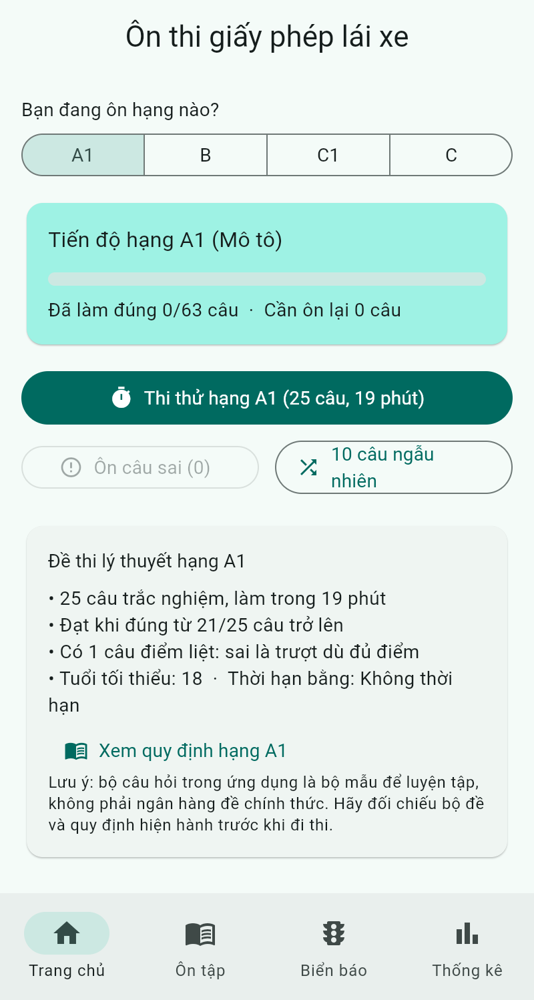
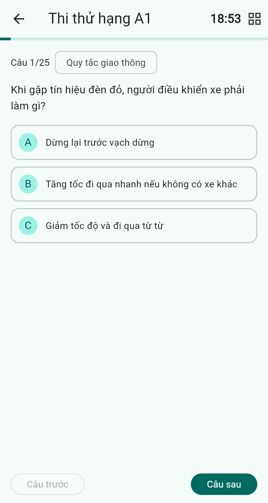
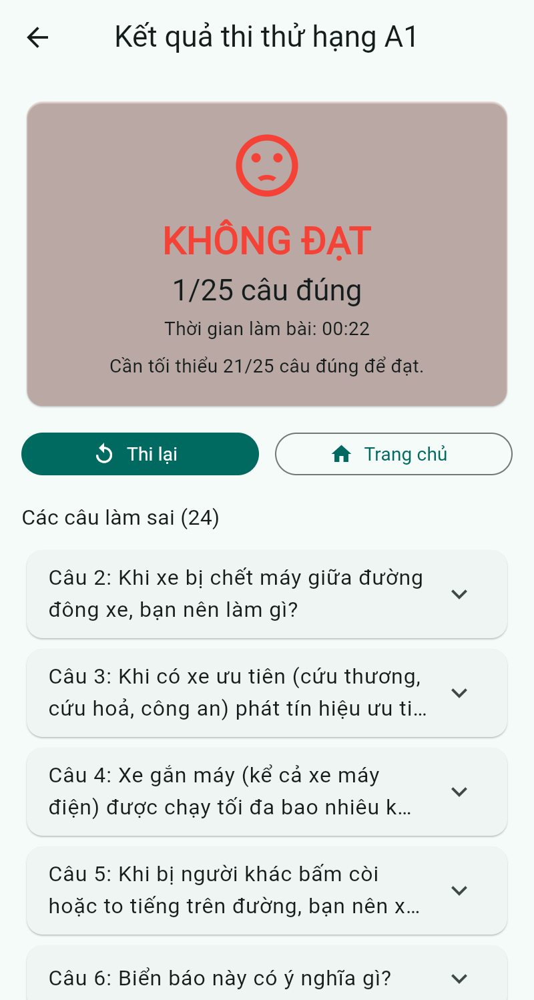
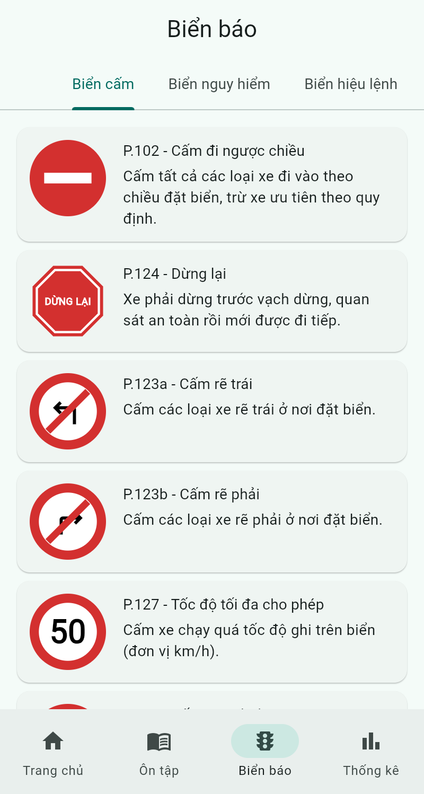

# Ôn thi giấy phép lái xe (Flutter)

[](https://github.com/haidangbdntbqn-bit/on-thi-gplx/actions/workflows/deploy-web.yml)

Ứng dụng ôn thi lý thuyết giấy phép lái xe **hạng A1, B, C1, C** theo quy định hiện hành của Việt Nam, chạy trên Android, iOS, web và macOS. Đồ án cá nhân môn Lập trình di động.

▶ **Dùng thử trên trình duyệt:** https://haidangbdntbqn-bit.github.io/on-thi-gplx/
📦 **Tải APK Android:** xem mục [Releases](https://github.com/haidangbdntbqn-bit/on-thi-gplx/releases)

| Trang chủ | Làm bài thi thử | Kết quả | Tra cứu biển báo |
|---|---|---|---|
|  |  |  |  |

## Chức năng

- **Chọn hạng bằng** A1, B, C1, C. Mỗi hạng có bộ câu hỏi và cấu trúc đề riêng; app nhớ hạng đã chọn.
- **Ôn tập theo chương**: quy tắc giao thông, tốc độ và khoảng cách, văn hoá người lái, kỹ thuật lái xe và cấu tạo xe, biển báo, nghiệp vụ vận tải. Báo đúng/sai ngay và có giải thích.
- **Thi thử** đúng cấu trúc đề từng hạng, có đồng hồ đếm ngược, đúng 1 câu điểm liệt, hết giờ tự nộp bài.
- **Ôn câu sai**, **10 câu ngẫu nhiên**.
- **Tra cứu biển báo** theo nhóm (cấm, nguy hiểm, hiệu lệnh, chỉ dẫn). Biển được vẽ bằng code, không cần mạng.
- **Thống kê** tiến độ và lịch sử thi thử, lưu trong máy bằng `shared_preferences`.
- **Màn hình Quy định**: loại xe được lái, tuổi, thời hạn bằng, quy trình sát hạch, văn bản căn cứ.

## Cấu trúc đề thi lý thuyết

| Hạng | Tuổi | Thời hạn | Hiện nay | Từ 01/3/2027 |
|---|---|---|---|---|
| A1 | 18 | Không thời hạn | 25 câu, 19 phút, đạt 21 | 40 câu, 27 phút, đạt 36 |
| B | 18 | 10 năm | 30 câu, 20 phút, đạt 27 | 50 câu, 33 phút, đạt 45 |
| C1 | 18 | 10 năm | 35 câu, 22 phút, đạt 32 | 60 câu, 40 phút, đạt 54 |
| C | 21 | 5 năm | 40 câu, 24 phút, đạt 36 | 70 câu, 47 phút, đạt 63 |

App tự chuyển sang cấu trúc mới theo ngày trên máy.

## Cài đặt và chạy

Yêu cầu: Flutter 3.x (Dart ≥ 3.13).

```bash
git clone https://github.com/haidangbdntbqn-bit/on-thi-gplx.git
cd on-thi-gplx
flutter pub get
flutter run            # chọn thiết bị: Android, iOS, Chrome, macOS
```

Kiểm tra code và chạy test:

```bash
flutter analyze
flutter test
```

## Cấu trúc thư mục

```
lib/
├── main.dart                     Khởi động app, đọc dữ liệu đã lưu
├── models/
│   ├── cau_hoi.dart              Câu hỏi, chương, phạm vi áp dụng
│   ├── hang_bang.dart            4 hạng bằng và cấu trúc đề từng hạng
│   └── ket_qua_thi.dart          Kết quả một lần thi thử (JSON)
├── data/
│   ├── ngan_hang.dart            Câu hỏi chung và xe máy
│   ├── ngan_hang_o_to.dart       Câu hỏi ô tô và xe tải
│   ├── bien_bao_data.dart        Danh sách biển báo
│   ├── quy_dinh.dart             Quy định chung, văn bản căn cứ
│   └── tao_de.dart               Lọc câu theo hạng, tạo đề thi
├── services/luu_tru.dart         Lưu tiến độ (shared_preferences)
├── widgets/bien_bao_widget.dart  Vẽ biển báo bằng CustomPaint
├── utils/dinh_dang.dart          Định dạng thời gian
└── screens/                      Trang chủ, ôn tập, làm bài, kết quả,
                                  biển báo, thống kê, quy định
test/widget_test.dart             10 bài test dữ liệu và giao diện
```

## Căn cứ pháp lý (tổng hợp ngày 17/11/2026)

- Luật Trật tự, an toàn giao thông đường bộ 2024 (36/2024/QH15)
- Luật 118/2025/QH15 sửa đổi, bổ sung (hiệu lực 01/7/2026)
- Thông tư 38/2024/TT-BGTVT về tốc độ và khoảng cách an toàn
- Thông tư 12/2025/TT-BCA và Thông tư 108/2026/TT-BCA về sát hạch, cấp giấy phép lái xe

## Lưu ý

Bộ 150 câu hỏi là bộ **mẫu tự soạn** để luyện tập, **không phải** ngân hàng đề chính thức của cơ quan có thẩm quyền.
Hình biển báo mang tính minh hoạ. Hãy đối chiếu văn bản và bộ đề chính thức trước khi đi thi.

## Tác giả

Nguyễn Hải Đăng – [github.com/haidangbdntbqn-bit](https://github.com/haidangbdntbqn-bit)
